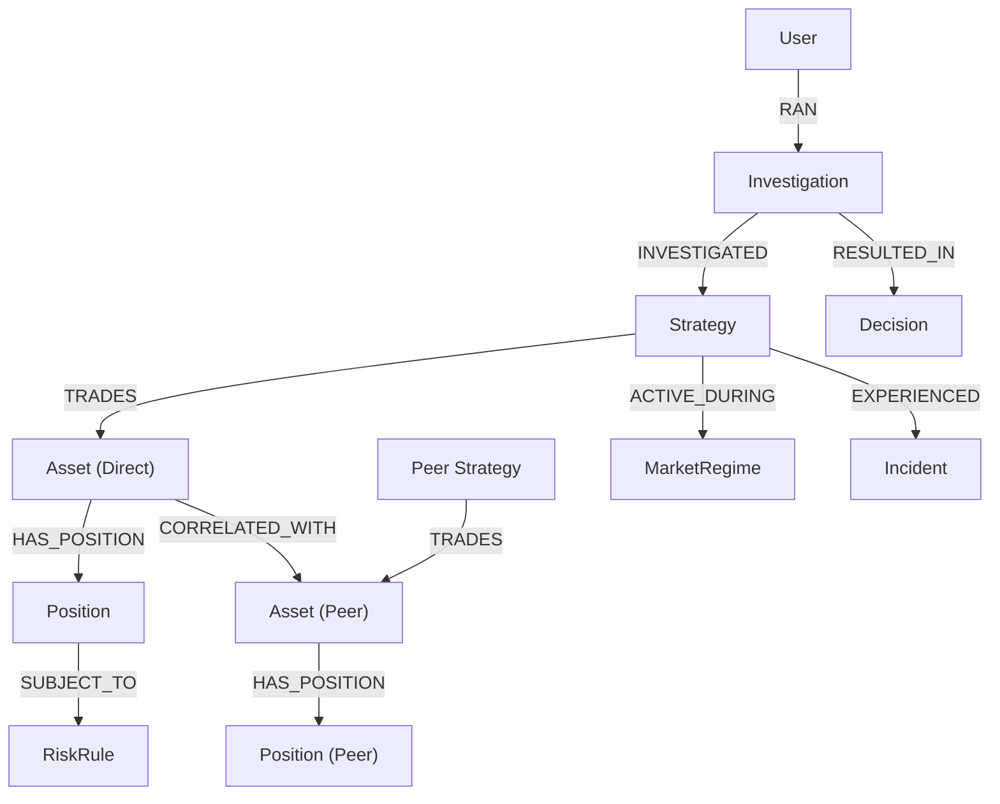

# AlphaTrace Graph Schema Specification

AlphaTrace models the trading organization, assets, correlations, codified risk rules, market regimes, historical incidents, and investigation memory in FalkorDB.

## Node Labels & Properties

### `Strategy`
- `id` (String, Indexed): Unique strategy identifier (e.g. `STRAT-QUANTUM-ALPHA`)
- `name` (String): Display name
- `description` (String): Investment mandate
- `pnl` (Float): Net cumulative profit/loss in USD
- `drawdown` (Float): Peak-to-trough drawdown percentage
- `sharpe` (Float): Annualized Sharpe ratio
- `updated_at` (String): ISO 8601 timestamp

### `Asset`
- `id` (String, Indexed): Unique asset ID (e.g. `ASSET-NVDA`)
- `symbol` (String, Indexed): Ticker symbol
- `asset_type` (String): Equity, Index ETF, Fixed Income, Commodity

### `Position`
- `id` (String, Indexed): Position ID
- `quantity` (Float): Number of shares/contracts
- `exposure` (Float): Dollar market value exposure in USD
- `currency` (String): Base currency (USD)
- `as_of` (String): Timestamp of valuation

### `RiskRule`
- `id` (String, Indexed): Rule identifier (e.g. `RR-CONC-01`)
- `metric` (String): Human-readable metric name
- `limit` (Float): Threshold ceiling
- `unit` (String): USD, Percentage, Ratio, Volatility Index
- `severity` (String): INFO, LOW, MEDIUM, HIGH, CRITICAL

### `MarketRegime`
- `id` (String, Indexed): Regime ID
- `label` (String): Market condition label (e.g. `High Volatility Dispersion`)
- `volatility` (Float): VIX-equivalent annualized volatility index
- `as_of` (String): Timestamp

### `Incident`
- `id` (String, Indexed): Incident identifier
- `description` (String): Causal narrative of market anomaly
- `timestamp` (String): Incident date/time
- `outcome` (String): Impact and liquidation consequences

### `User`
- `id` (String, Indexed): User ID
- `display_name` (String): Risk officer name and title

### `Investigation`
- `id` (String, Indexed): Unique investigation ID
- `user_id` (String): User initiating investigation
- `strategy_id` (String): Target strategy
- `question` (String): Investigation inquiry
- `created_at` (String): ISO 8601 timestamp
- `status` (String): COMPLETED, IN_PROGRESS, FAILED
- `result_json` (String): Serialized structured findings

### `Decision`
- `id` (String, Indexed): Decision ID
- `action` (String): REDUCE_OR_HEDGE_EXPOSURE, APPROVE_CURRENT_ALLOCATION
- `reason` (String): Mathematical justification and hedging guidance
- `status` (String): PENDING, APPROVED, REJECTED, EXECUTED
- `created_at` (String): ISO 8601 timestamp

---

## Relationship Types & Semantics

| Relationship | Source Node | Target Node | Properties | Semantics |
|---|---|---|---|---|
| `TRADES` | `Strategy` | `Asset` | None | Defines an active trading allocation |
| `CORRELATED_WITH` | `Asset` | `Asset` | `coefficient` (Float), `regime` (String) | Statistical return correlation between assets |
| `HAS_POSITION` | `Asset` | `Position` | None | Direct market position valuation |
| `SUBJECT_TO` | `Position` | `RiskRule` | None | Codified risk governance constraints |
| `ACTIVE_DURING` | `Strategy` | `MarketRegime` | None | Current prevailing volatility environment |
| `EXPERIENCED` | `Strategy` | `Incident` | None | Historical stress events and precedents |
| `RAN` | `User` | `Investigation` | None | Audit trail of risk officer actions |
| `INVESTIGATED` | `Investigation` | `Strategy` | None | Target of risk inquiry |
| `RESULTED_IN` | `Investigation` | `Decision` | None | Actionable risk recommendation |
